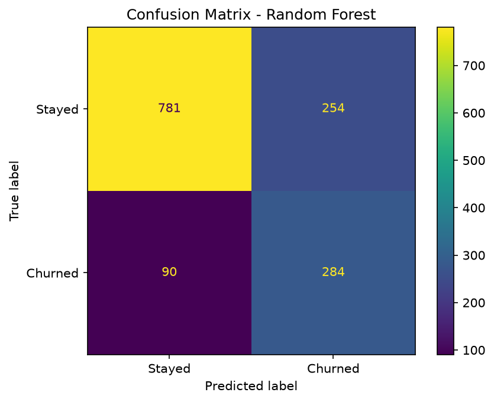
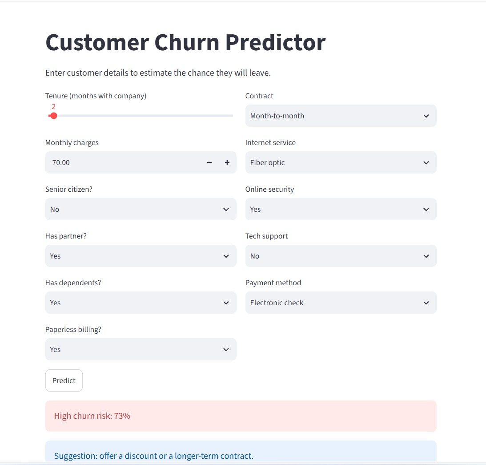
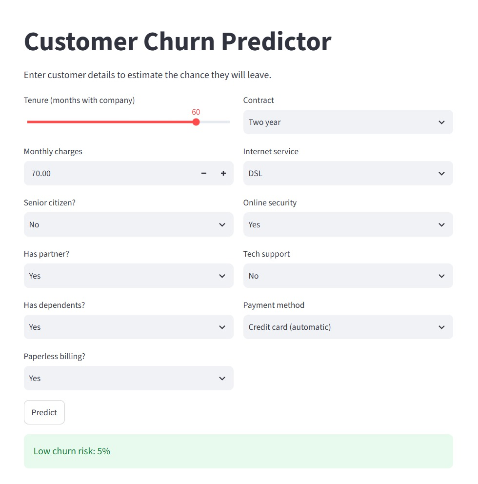

# Customer Churn Prediction System

A machine learning project that predicts whether a telecom customer will
churn, with a Streamlit web app for real-time predictions.

## Problem Statement
Retaining customers costs less than acquiring new ones. This model flags
high-risk customers so a company can act early.

## Dataset
Telco Customer Churn dataset (7,043 customers, 11 features used).
About 26% of customers churned (imbalanced classes).

## Approach
1. Encoded categorical features and scaled numeric features (ColumnTransformer)
2. Used a Scikit-learn Pipeline to prevent data leakage
3. Handled class imbalance with stratified splitting and class weights
4. Compared Logistic Regression, Random Forest, and Gradient Boosting
5. Selected the best model using F1-score on the churn class

## Results
| Model | Accuracy | Precision | Recall | F1 |
|---|---|---|---|---|
| Logistic Regression | 0.739 | 0.505 | 0.797 | 0.618 |
| Random Forest | 0.756 | 0.528 | 0.759 | 0.623 |
| Gradient Boosting | 0.801 | 0.661 | 0.511 | 0.576 |

Random Forest was selected: Gradient Boosting has higher accuracy but
catches only 51% of churners, and recall matters more when missing a
churner is costly.



## App Screenshots



## How to Run
```bash
pip install -r requirements.txt
python train.py
streamlit run app.py
```

## Tech Stack
Python, Pandas, NumPy, Scikit-learn, Matplotlib, Streamlit

## Future Work
- Hyperparameter tuning and cross-validation
- Feature importance / SHAP explanations
- Online deployment